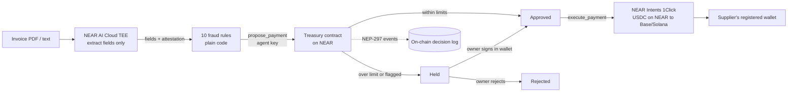

# Warden

**AI that pays real invoices. Nothing else.**

Warden is an AI finance agent for small businesses that pay overseas suppliers in stablecoins. It reads each supplier invoice privately on **NEAR AI Cloud**, checks it against ten fixed fraud rules, and asks a **NEAR smart contract** to pay or hold it. Clean invoices are paid through **NEAR Intents (1Click API)** to the supplier's registered wallet on Base or Solana. Suspicious ones wait for the owner, who approves or rejects them with their own **NEAR wallet**. Every decision is recorded on-chain.

- **Demo video:** _add the YouTube link here before submitting_
- **Track:** AI Security & Defense (also fits Real-World Money and Autonomous Business)
- **Live contract (testnet):** [`warden-treasury-cowry.testnet`](https://testnet.nearblocks.io/address/warden-treasury-cowry.testnet), funded with 15 testnet USDC

---

## Sponsor and NEAR technologies used

| Technology | What Warden uses it for | Where in the code | Status |
|---|---|---|---|
| **NEAR AI Cloud** (private inference in a TEE) | Reads each invoice inside a secure enclave with the attested model `Qwen/Qwen3.6-35B-A3B-FP8`, using JSON-mode structured output. The AI only extracts fields; it never decides. | [`agent/src/extract/client.ts`](agent/src/extract/client.ts), [`agent/src/extract/prompt.ts`](agent/src/extract/prompt.ts), [`agent/src/extract/schema.ts`](agent/src/extract/schema.ts) | Integrated. Live calls currently return HTTP 402 (no credits on the team's NEAR AI account), so the demo replays recorded extractions. |
| **NEAR AI Cloud attestation** | Fetches the enclave attestation report and signature for every chat, hashes them, and stores the hash on-chain with the payment so anyone can check the AI ran in a TEE. | [`agent/src/extract/attestation.ts`](agent/src/extract/attestation.ts), [`scripts/verify-attestation.ts`](scripts/verify-attestation.ts) | Integrated. Verification checks evidence integrity; full Intel root-of-trust verification is not included. |
| **NEAR Intents: 1Click API** | Turns USDC on NEAR into USDC on Base or USDT on Solana for the supplier. Warden requests a quote (`/v0/quote`), **re-verifies the recipient, asset and amount against the on-chain supplier registry**, has the contract send funds to the deposit address, then submits and polls status (`/v0/deposit/submit`, `/v0/status`). | [`backend/src/pay/oneclick.ts`](backend/src/pay/oneclick.ts), [`backend/src/app.ts`](backend/src/app.ts) (`executePaymentFlow`) | Integrated against the documented API. NEAR Intents has no testnet, so live settlement needs the mainnet deploy (pending funding). |
| **NEAR smart contract** (Rust, `near-sdk` 5.30) | The treasury. Holds USDC, keeps the supplier registry, enforces the auto-pay limit, per-payment cap, daily cap and per-supplier maximum, blocks duplicate invoice hashes, holds payments for the owner, and has a pause switch. Only the contract can move money. | [`smart-contract/src/lib.rs`](smart-contract/src/lib.rs), [`smart-contract/src/types.rs`](smart-contract/src/types.rs) | **Deployed on testnet** at `warden-treasury-cowry.testnet`. Mainnet deploy is pending funding (about 2.2 NEAR of storage for the 218 KB contract). |
| **NEP-297 events** | Every decision emits an `EVENT_JSON` log (`payment_proposed`, `payment_held`, `payment_approved`, `payment_rejected`, `payment_sending`, `payment_sent`, `payment_settled`, `payment_failed`, `vendor_updated`, `limits_updated`, `paused`), so the full history can be rebuilt from the chain. | [`smart-contract/src/events.rs`](smart-contract/src/events.rs), [`scripts/audit.ts`](scripts/audit.ts) | Live on testnet. |
| **NEP-141 fungible tokens: Circle USDC on NEAR** | The treasury holds USDC. Top-ups go through `ft_transfer_call`, and `ft_on_transfer` accepts funds only from the configured USDC token and only from the owner. | [`smart-contract/src/lib.rs`](smart-contract/src/lib.rs) (`ft_on_transfer`, `execute_payment`, `withdraw`) | Live on testnet with Circle's testnet USDC (`3e2210e1184b45b64c8a434c0a7e7b23cc04ea7eb7a6c3c32520d03d4afcb8af`). Mainnet uses `17208628f84f5d6ad33f0da3bbbeb27ffcb398eac501a31bd6ad2011e36133a1`. |
| **NEAR Wallet Selector** (Meteor Wallet, MyNearWallet) | The business owner signs `approve_payment`, `reject_payment`, `set_limits`, `pause` and `unpause` from the browser. Warden's server never holds the owner's key. | [`frontend/lib/near-wallet.ts`](frontend/lib/near-wallet.ts), [`frontend/components/wallet-provider.tsx`](frontend/components/wallet-provider.tsx) | Integrated (testnet). |
| **near-api-js** | The backend acts as the agent account and calls `propose_payment`, `execute_payment` and `mark_settled`, and reads views. Transaction hashes are captured for the decision log. | [`backend/src/chain/client.ts`](backend/src/chain/client.ts) | Live on testnet. |
| **FastNEAR RPC** | RPC endpoint for the backend (`rpc.testnet.fastnear.com`) and Wallet Selector. | [`.env.example`](.env.example) | Live. |

---

## How it works



1. **Upload.** The owner uploads a supplier invoice. Warden fingerprints the file (SHA-256) so it can never be paid twice.
2. **Read privately.** NEAR AI Cloud extracts supplier, amount, dates, line items and payment details inside a TEE, and lists any instruction-like text instead of following it. The attestation is fetched and hashed.
3. **Check 10 rules.** Deterministic code compares the invoice with the supplier registry and payment history. Reasons are written by code templates, not by the AI.
4. **The contract decides.** The agent proposes the payment. The treasury contract re-checks every limit and the registry itself, then approves, holds or rejects it.
5. **Pay or hold.** Approved payments go through NEAR Intents to the address in the **on-chain registry**; the address written on the invoice is never used. Held payments wait for the owner's wallet signature.
6. **Logged.** Every step is an on-chain event, with the invoice hash and attestation hash stored on the payment.

## Security model

Three independent layers, so a clever invoice, a model mistake or a compromised server still can't send money to the wrong place.

| Layer | Can it move money? | What stops abuse |
|---|---|---|
| **AI** (NEAR AI Cloud) | No | Extracts fields into a fixed schema. Invoice text is treated as hostile input. Hidden instructions are flagged (rule R7), never followed. |
| **Rules + backend** | Only what the contract allows | Ten fixed checks. The agent key can call three contract methods and nothing else (see limitations). |
| **Treasury contract** | Yes, the only thing that can | Pays only registered suppliers at their registered address, within the auto-pay limit, per-payment cap, daily cap and supplier maximum. Rejects reused invoice hashes. Only the owner can approve held payments, change limits or pause. |

### The 10 fraud rules

| Rule | Checks | Flag | Result |
|---|---|---|---|
| R1 | Supplier is in the approved registry | `UNKNOWN_VENDOR` | Hold |
| R2 | Payment address on the invoice matches the registry | `DEST_MISMATCH` | Hold |
| R3 | Amount is within the supplier's usual range | `AMOUNT_ANOMALY`, `THIN_HISTORY` | Hold |
| R4 | Invoice number never used before | `DUPLICATE_NUMBER` | **Block** |
| R5 | Not a re-sent copy (same amount, recent, edited) | `NEAR_DUPLICATE` | Hold |
| R6 | Currency matches the supplier's usual one | `CURRENCY_CHANGE` | Hold |
| R7 | No hidden or AI-directed instructions | `INJECTION_TEXT` | Hold |
| R8 | Line items add up to the total | `TOTAL_MISMATCH` | Hold |
| R9 | The AI read the invoice with enough confidence | `LOW_CONFIDENCE` | Hold |
| R10 | Issue and due dates make sense | `DATE_ANOMALY` | Hold |

The contract adds its own flags: `OVER_AUTO_PAY_LIMIT`, `OVER_VENDOR_MAX`, `OVER_DAILY_CAP`, `OVER_HARD_CAP`, `DUPLICATE_HASH`, `UNKNOWN_VENDOR`.

Code: [`agent/src/risk/`](agent/src/risk/). Tests: [`agent/test/fraud.test.ts`](agent/test/fraud.test.ts) runs all 13 scenarios in [`fixtures/invoices/`](fixtures/invoices/) and checks each against [`expected.json`](fixtures/invoices/expected.json).

### Contract roles

| Role | Methods |
|---|---|
| Owner (business, signs in wallet) | `approve_payment`, `reject_payment`, `set_limits`, `pause`, `unpause`, `upsert_vendor`, `deactivate_vendor`, `set_agent`, `withdraw` |
| Agent (Warden backend) | `propose_payment`, `execute_payment`, `mark_settled` |
| Anyone | `get_config`, `get_payment`, `list_payments`, `get_vendor`, `list_vendors` |

## Demo scenarios

The repo includes 13 test invoices covering normal payments and every attack Warden is built to stop: a changed payout wallet, hidden AI instructions, a new unknown supplier, a lookalike supplier name, an inflated amount, a duplicate, a re-sent edited copy, a currency switch, line items that don't add up, an urgent future-dated invoice, and a large legitimate invoice that needs owner approval.

The dashboard has a **demo mode** (`NEXT_PUBLIC_DEMO_MODE=true`) that runs all 13 in the browser with no keys, so judges can click through every case. Two plain-text samples for a live upload are in [`fixtures/samples/`](fixtures/samples/).

## Repo layout

| Folder | What it is |
|---|---|
| [`frontend/`](frontend/) | Next.js 15 dashboard and landing page. Talks to the backend through a same-origin proxy (`/backend/*`) and to the contract through the owner's wallet. |
| [`backend/`](backend/) | Express API: upload pipeline, contract calls as the agent, 1Click payments, SQLite storage. API contract in [`docs/api.md`](docs/api.md). |
| [`agent/`](agent/) | NEAR AI Cloud extraction and attestation, plus fraud rules R1–R10. No keys, no chain access. |
| [`smart-contract/`](smart-contract/) | Rust treasury contract. |
| [`fixtures/`](fixtures/) | Demo suppliers, payment history and the 13 test invoices. |
| [`scripts/`](scripts/) | `audit.ts` (rebuild history from on-chain events), `verify-attestation.ts`. |

## Run it locally

Requirements: Node 22, Rust 1.95 (pinned in `smart-contract/rust-toolchain.toml`).

```bash
npm install

# Dashboard only, with sample data (no keys needed)
cp frontend/.env.example frontend/.env     # keep NEXT_PUBLIC_DEMO_MODE=true
npm run dev:frontend                       # http://localhost:3000

# Full stack against the testnet contract
cp .env.example .env                       # fill in keys; never commit .env
# in frontend/.env set NEXT_PUBLIC_DEMO_MODE=false
npm run dev                                # backend on :4000
npm run dev:frontend                       # frontend on :3000
```

## Tests

```bash
npm test                 # agent 14, backend 13, frontend 11 tests
npm run test:fraud       # all 13 fraud scenarios, no API key needed
npm run test:contract    # 15 Rust contract unit tests
npm run lint && npm run typecheck
```

CI runs all of these plus a [gitleaks](.gitleaks.toml) secret scan on every push ([`.github/workflows/ci.yml`](.github/workflows/ci.yml)).

## Status and known limitations

We would rather state these plainly than have a reviewer find them.

- **Mainnet is not deployed yet.** The contract runs on testnet. Mainnet needs about 2.5–3 NEAR for storage and setup.
- **No live supplier payment yet.** NEAR Intents is mainnet-only, so the 1Click leg (`execute_payment` → 1Click → supplier) has not run end to end. It is implemented against the documented API, and the contract's transfer and callback bookkeeping are unit-tested.
- **NEAR AI Cloud credits.** Live extraction returns HTTP 402 on the team account at submission time. The integration is complete; the demo video uses demo mode with recorded extractions, and says so.
- **Agent key.** The design gives the agent a function-call key limited to `propose_payment`, `execute_payment` and `mark_settled`. The testnet agent account still uses a full-access key; switching it is a deployment step before mainnet. The contract's own `assert_agent` check limits those methods to the agent account either way.
- **Attestation verification** checks the integrity of the stored evidence against the on-chain hash, not Intel's TEE root of trust.
- **Payment execution is synchronous.** `POST /payments/:id/execute` waits for 1Click to settle in one request. That is fine at demo amounts ($1–3) but would need a job queue at scale.

## Team

Cowry, for the NEAR HACKATHON (November 2026).

## License

MIT
